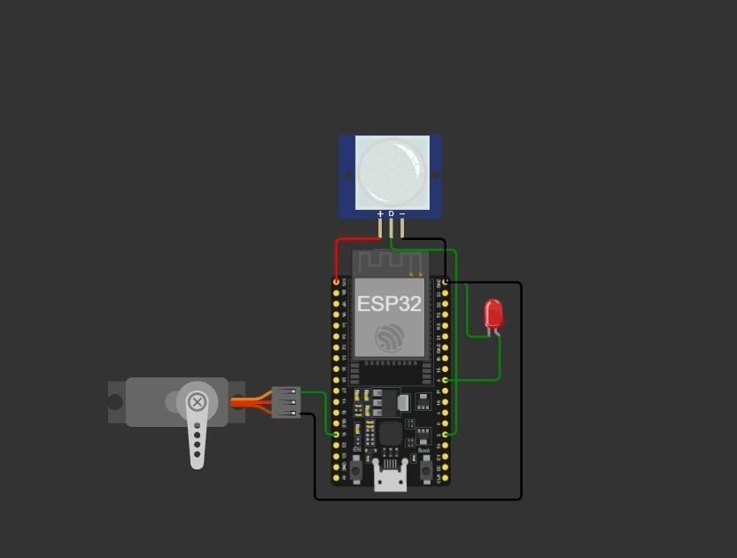
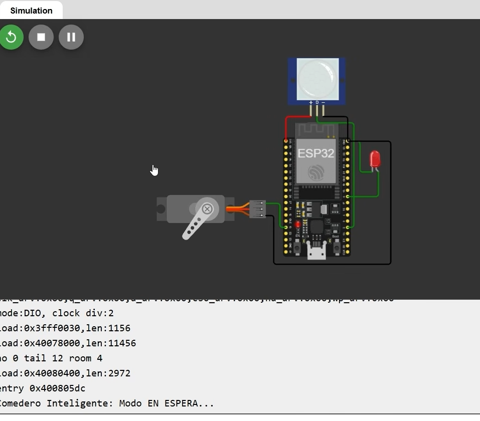
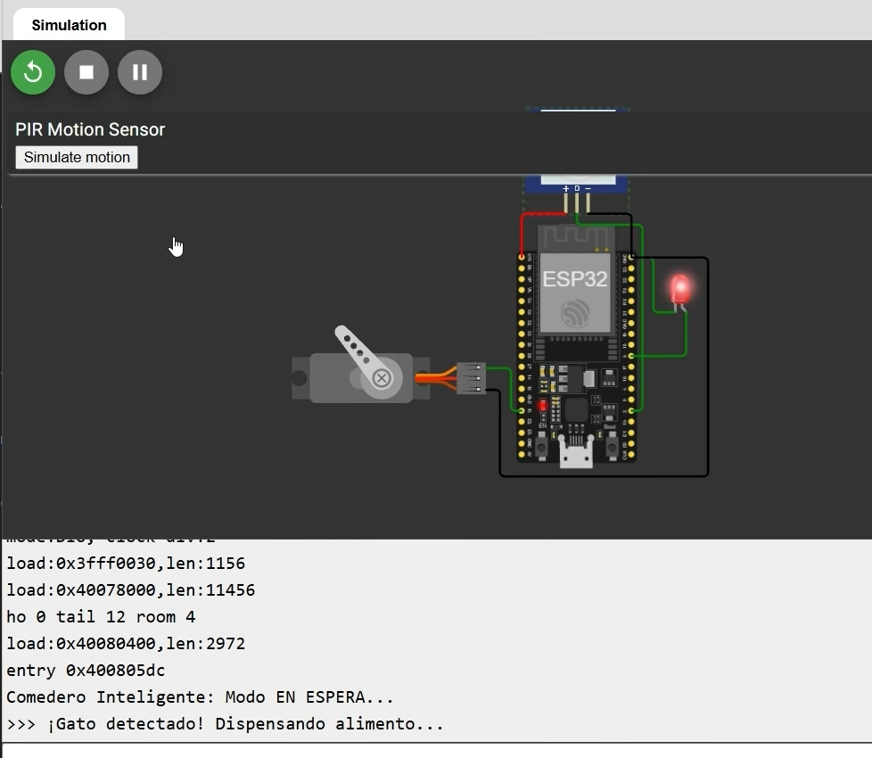
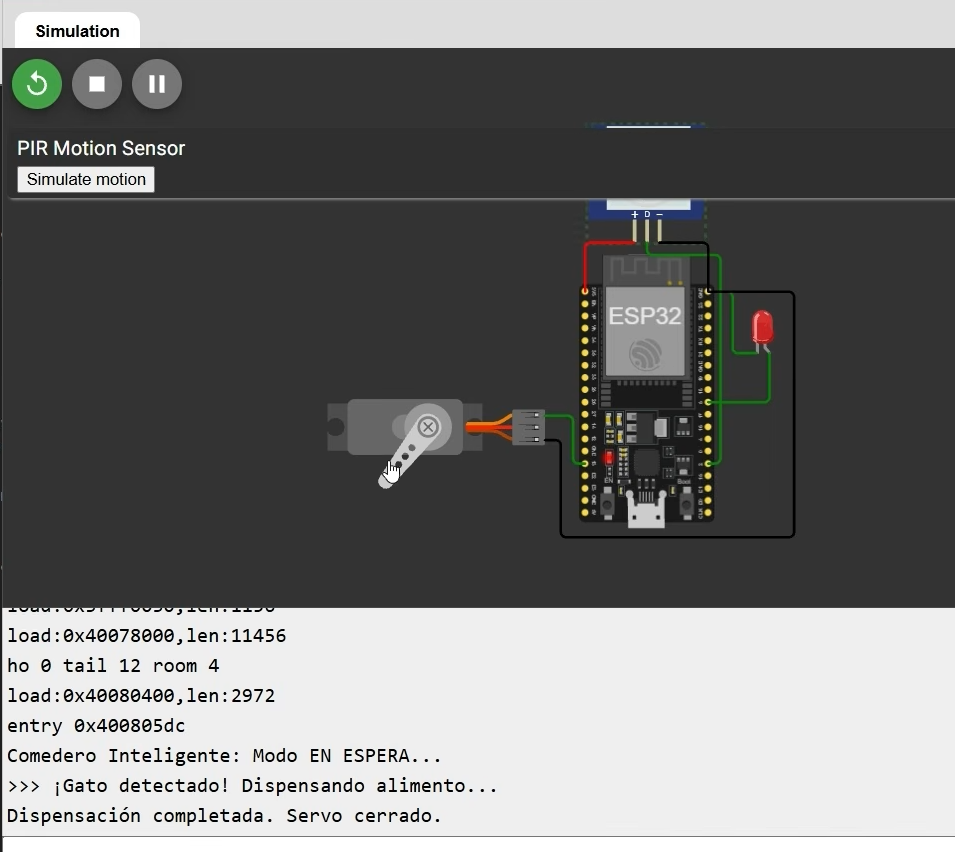
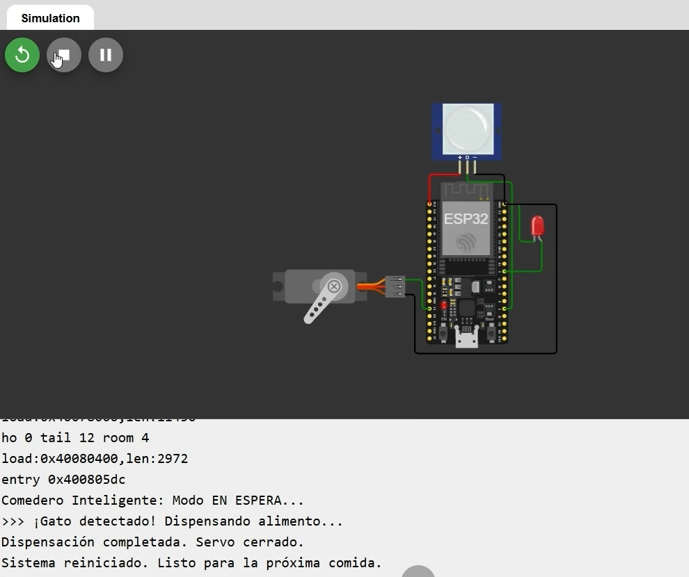

# Comedero Inteligente para Gatos
Proyecto del curso EL-1200 Introducción a la Electrónica, TEC, II semestre 2026.
**Integrantes:** <Karla Murillo>, <Amanda Brown>, <Yamileth Estrada>
## Descripción
Comedero automático que dispensa alimento solo cuando detecta al gato
y evita servir de más si el gato se queda frente al plato.
## Funcionamiento
- El sensor PIR detecta la presencia del gato.
- El servomotor abre la compuerta 1,5 s y la vuelve a cerrar.
- El LED indica que se está sirviendo.
- Una variable booleana (dispensado) evita que se sirva otra vez
 mientras el gato sigue ahí.
## Conexiones
| Componente | Pin del ESP32 |
|-----------------|---------------|
| Sensor PIR | GPIO 2 |
| Servomotor | GPIO 13 |
| LED (con 220 Ω) | GPIO 5 |
| Alimentación | 3V3 y GND |

## Simulación
Proyecto en Wokwi: https://wokwi.com/projects/480767850237652993
## Código
Ver la carpeta firmware/. Biblioteca usada: ESP32Servo.
## Evidencia

## Mejoras futuras
- Incorporar un sistema de horarios para controlar los momentos de alimentación.
- Agregar un sensor de nivel para conocer la cantidad de alimento disponible.
- Implementar notificaciones por Wi-Fi para informar sobre el funcionamiento del comedero.
